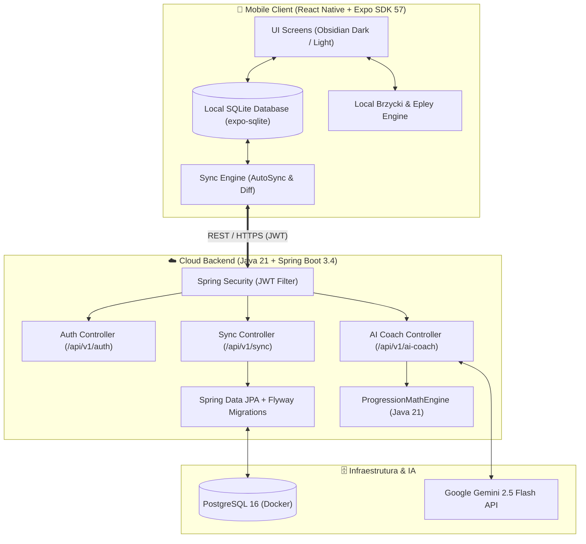

# 🏋️ FocusLift — Full-Stack Gym Progression & AI Analytics Platform

<p align="center">
  <strong>Plataforma Full-Stack de Alta Performance para Musculação & Sobrecarga Progressiva</strong><br>
  <em>Mobile Offline-First (React Native + Expo + SQLite) & Cloud REST API (Java 21 + Spring Boot 3 + PostgreSQL + Docker)</em>
</p>

<p align="center">
  <a href="https://expo.dev/artifacts/eas/yUWOt6eXYN2fcoSmgQ71RwozV-OKAWUlmjetNkYxwHU.apk">
    
  </a>
  
  
  
  
  
  
  
</p>

---

## 📌 Visão Geral & Proposta de Valor

O **FocusLift** é uma solução completa de engenharia de software full-stack desenvolvida para resolver os desafios reais do treinamento de força:
1. **Uso 100% Offline na Academia:** Funciona sem sinal de internet ou Wi-Fi por meio de banco de dados SQLite local reativo, garantindo zero latência ao anotar cargas entre as séries.
2. **Backend Corporativo em Java 21 & Spring Boot 3.4:** API RESTful robusta, segura e conteinerizada para sincronização bidirecional na nuvem, autenticação stateless JWT e processamento analítico.
3. **AI Coach com Matemática Determinística (Anti-Alucinação):** Integração com **Google Gemini 2.5 Flash** blindada por um motor matemático em Java (`ProgressionMathEngine`), onde cálculos de 1RM (Brzycki), volume semanal e platôs são validados no código antes de compor o prompt do LLM.

---

## 🏛️ Arquitetura do Sistema



---

## ⚡ Destaques Técnicos

### ☕ Backend (Java 21, Spring Boot 3.4, PostgreSQL)
- **Arquitetura em Camadas:** Padrão corporativo estrito com Controller, Service, Repository, DTOs e Mappers.
- **Segurança com Spring Security 6 & JWT:** Autenticação stateless via JJWT (0.12.6), senhas criptografadas com **BCrypt**, proteção CSRF/CORS configurada e filtros de autorização por Bearer Token.
- **Sincronização Idempotente com Tombstones:** Endpoints `/api/v1/sync/push` e `/api/v1/sync/pull` com suporte a exclusões lógicas (*tombstones*), reconciliação por carimbo de data/hora (`updated_at`) e tratamento de IDs locais.
- **Flyway Database Migrations:** Controle de versão de esquema relacional em SQL puro (`V1__init_schema.sql`) com índices de alta performance (`idx_workouts_user_date`, `idx_sets_exercise`).
- **Containerização Multi-Stage:** `Dockerfile` otimizado em 2 estágios (Maven Alpine para compilação e Eclipse Temurin 21 JRE Alpine para execução mínima e segura).
- **Orquestração com Docker Compose:** Configuração completa com subida automática do banco de dados PostgreSQL 16 e do serviço Spring Boot (`docker compose up --build`).
- **Documentação Interativa OpenAPI 3 / Swagger:** Interface Swagger UI integrada acessível em `/swagger-ui.html`.

### 📱 Mobile (React Native, Expo SDK 57, TypeScript)
- **Offline-First com SQLite:** Todas as operações (criação de treinos, séries, repetições, hábitos) gravam instantaneamente no banco de dados SQLite local com queries parametrizadas (proteção contra SQL Injection).
- **Auto-Sync Transparente:** Sincronizador em background que detecta conectividade e envia deltas ao backend Spring Boot sem bloquear a interface.
- **Sessão de Treino em Tempo Real:**
  - Comparativo automático com a série equivalente da última sessão (`+kg`, `+reps`).
  - Detecção em tempo de execução de Recorde Pessoal histórico (PR).
  - Preenchimento rápido em 1 toque ("Repetir treino anterior").
  - Suporte a cargas por **Peso Total** ou **Por Lado (Halteres/Unilateral)**.
  - Seletor de tipo de série (**Normal**, **Aquecimento**, **Dropset**, **Falha**) e escala **RPE 6–10**.
  - Persistência e recuperação de treinos interrompidos acidentalmente.
- **Calculadora Visual de Barras & Anilhas:** Algoritmo ganancioso (*greedy*) para distribuição de anilhas olímpicas (1.25kg até 25kg) com visualização gráfica da barra montada.
- **Design System Obsidian:** Temas Dark e Light de alto contraste calibrados para uso em ambientes de academia.
- **Internacionalização (i18n):** Suporte completo a 5 idiomas (`PT-BR`, `EN`, `ES`, `DE`, `FR`) e unidades `kg` / `lbs`.

---

## 🧠 Arquitetura Anti-Alucinação de IA

Para evitar que LLMs inventem cálculos matemáticos ou forneçam progressões perigosas, o FocusLift adota o padrão **Deterministic Math Injection**:

1. **Cálculo Determinístico no Backend:** O motor em Java ([`ProgressionMathEngine.java`](backend/src/main/java/com/focuslift/service/ProgressionMathEngine.java)) processa o histórico real do banco:
   - Estimativa de 1RM com Brzycki: $\text{1RM} = \text{peso} \times \frac{36}{37 - \min(\text{reps}, 12)}$ (válido para $1 \le \text{reps} \le 12$, excluindo séries de aquecimento).
   - Tonnage total semanal e delta percentual de volume.
   - Detecção formal de platô ($\ge 3$ sessões consecutivas sem evolução de carga e $\text{RPE} \ge 8.0$).
2. **Injeção de Fatos Estruturados:** O diagnóstico matemático comprovado é formatado e inserido no contexto da chamada ao **Google Gemini 2.5 Flash**.
3. **Prescrição Tática:** O modelo de IA atua exclusivamente na estratégia (deload, ajuste de volume, dicas de execução e biomecânica), eliminando qualquer risco de alucinação aritmética.
4. **Resiliência Offline:** Se o dispositivo estiver sem conexão com a internet, o aplicativo executa os cálculos localmente no motor TypeScript ([`progressionCalculator.ts`](src/utils/progressionCalculator.ts)) sem interromper o usuário.

---

## 📡 Endpoints da API REST (Spring Boot)

| Método | Endpoint | Autenticação | Descrição |
|---|---|---|---|
| `POST` | `/api/v1/auth/register` | Pública | Cadastro de novo atleta com validação e hash BCrypt |
| `POST` | `/api/v1/auth/login` | Pública | Login com credenciais e geração de token JWT (10h de validade) |
| `POST` | `/api/v1/sync/push` | `Bearer JWT` | Envio em lote de treinos, séries, hábitos e tombstones do mobile |
| `GET` | `/api/v1/sync/pull` | `Bearer JWT` | Download incremental de alterações ocorridas após `lastPulledAt` |
| `POST` | `/api/v1/ai-coach/analyze` | `Bearer JWT` | Análise determinística de sobrecarga progressiva com IA Gemini |
| `GET` | `/api/v1/health` | Pública | Verificação de disponibilidade e integridade do serviço |

Documentação Swagger interativa: `http://localhost:8080/swagger-ui.html`

---

## 📂 Estrutura do Repositório

```text
FocusLift/
├── backend/                              # API REST em Java 21 + Spring Boot 3.4
│   ├── src/main/java/com/focuslift/
│   │   ├── config/                       # SecurityConfig, JwtFilter, OpenApiConfig (Swagger)
│   │   ├── controller/                   # Controllers REST (Auth, Sync, AiCoach, Health)
│   │   ├── dto/                          # Records e DTOs tipados para Auth, Sync e IA
│   │   ├── model/                        # Entidades JPA (User, Workout, Exercise, WorkoutSet, Routine)
│   │   ├── repository/                   # Spring Data JPA Repositories
│   │   └── service/                      # ProgressionMathEngine, AiCoachService, SyncService, AuthService
│   ├── src/main/resources/
│   │   ├── application.yml               # Configurações de perfis (dev/prod)
│   │   └── db/migration/                 # Flyway Schema Migrations (V1__init_schema.sql)
│   ├── Dockerfile                        # Multi-Stage Build (Maven Alpine -> Temurin JRE 21 Alpine)
│   └── pom.xml                           # Dependências Maven (Spring Boot, Security, JJWT, Flyway)
├── src/                                  # Mobile App em React Native + Expo SDK 57
│   ├── components/                       # Componentes modulares (AiCoachModal, PlateCalculator, etc.)
│   ├── contexts/                         # React Contexts (AuthContext, ThemeContext, SubscriptionContext)
│   ├── database/                         # SQLite Local-First (Schema, Migrations e Queries Otimizadas)
│   ├── i18n/                             # Traduções nativas (PT, EN, ES, DE, FR)
│   ├── screens/                          # Telas principais (WorkoutSession, Evolution, Routine, etc.)
│   ├── services/                         # Integração de APIs (springApiService, authService, syncService)
│   ├── theme/                            # Design tokens Dark & Light Obsidian
│   └── utils/                            # Parsers (RFC 4180 CSV, Brzycki 1RM, Text Workout Parser)
├── docs/
│   └── BUSINESS_RULES.md                 # Especificação técnica das regras de progressão e fórmulas
├── docker-compose.yml                    # Orquestração do Backend + PostgreSQL 16
├── app.json                              # Manifesto e configurações Expo / EAS
└── package.json
```

---

## 🚀 Como Executar

### 1. Subindo o Backend & Banco de Dados (Docker Compose)
Com o Docker instalado, execute na raiz do projeto:
```bash
docker compose up --build
```
- **API Base:** `http://localhost:8080/api/v1`
- **Swagger UI:** `http://localhost:8080/swagger-ui.html`
- **PostgreSQL:** `localhost:5432` (banco `focuslift_db`)

Para executar apenas os testes unitários e de integração do backend:
```bash
cd backend
./mvnw test
```

### 2. Executando o Aplicativo Mobile
Com o Node.js 18+ instalado:
```bash
# Instalação das dependências
npm install

# Inicialização do servidor Expo
npx expo start
```
- Pressione `a` para abrir no emulador Android ou leia o QR Code com o aplicativo **Expo Go**.
- Para executar os testes do aplicativo:
```bash
npm test
```

### 3. Deploy na Nuvem (Render / Railway)
Para disponibilizar a API 24h online com PostgreSQL gerenciado e conectar o aplicativo de qualquer lugar via 4G/Wi-Fi:
👉 Consulte o [Guia Completo de Deploy na Nuvem (docs/CLOUD_DEPLOY_GUIDE.md)](docs/CLOUD_DEPLOY_GUIDE.md) — inclui suporte nativo a 1 clique via Blueprint [`render.yaml`](render.yaml).

### 4. Teste Rápido no Celular via APK
Se desejar testar diretamente no aparelho físico sem configurar ambiente de desenvolvimento:
👉 **[Download Direto do APK FocusLift](https://expo.dev/artifacts/eas/yUWOt6eXYN2fcoSmgQ71RwozV-OKAWUlmjetNkYxwHU.apk)**

---

## 🔒 Segurança e Privacidade

- **Consultas SQL 100% Parametrizadas:** Proteção estrita contra SQL Injection tanto no SQLite local quanto via Spring Data JPA.
- **Autenticação Stateless JWT:** Criptografia de senhas com algoritmo BCrypt e validação de tokens HMAC-SHA256 em todas as rotas protegidas.
- **Prevenção de CSV Formula Injection:** Higienização de caracteres executáveis (`=`, `+`, `-`, `@`) ao exportar históricos de treino.
- **Isolamento Multi-Tenant:** Segregação rígida de registros no banco de dados por `user_id`.

---

## 📄 Licença e Direitos Autorais

Copyright © 2026 **Igor Sena Hagge** ([@Igor8818](https://github.com/Igor8818)). Todos os direitos reservados.

O código-fonte deste repositório é disponibilizado publicamente para **fins de portfólio, avaliação técnica e estudo arquitetural**. Não é permitida a redistribuição comercial ou publicação de cópias/derivados nas lojas de aplicativos (Google Play Store / Apple App Store) sem autorização expressa do autor.
